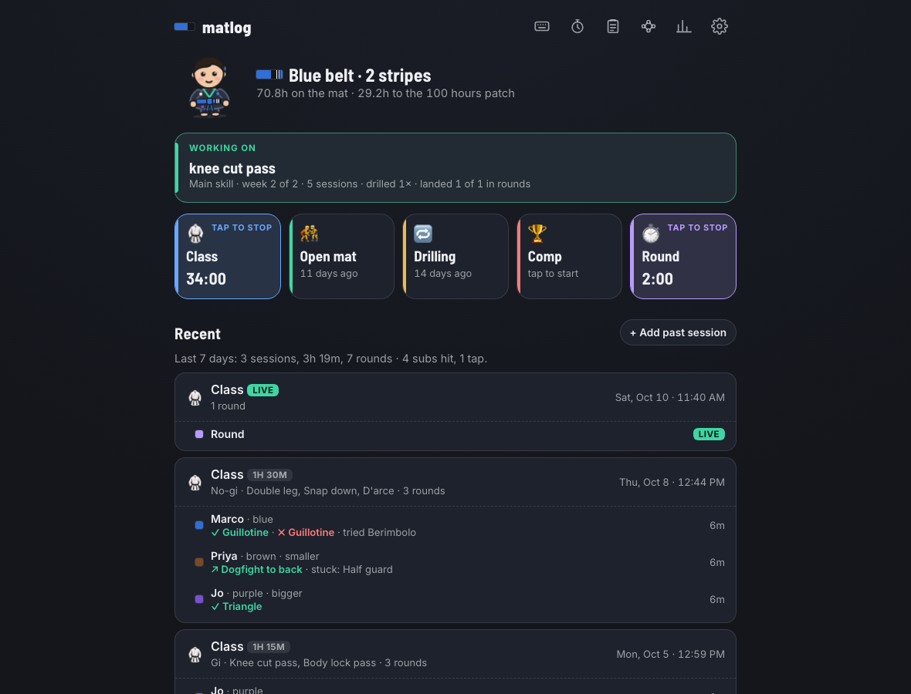
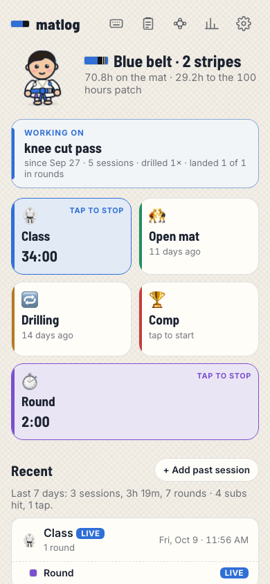
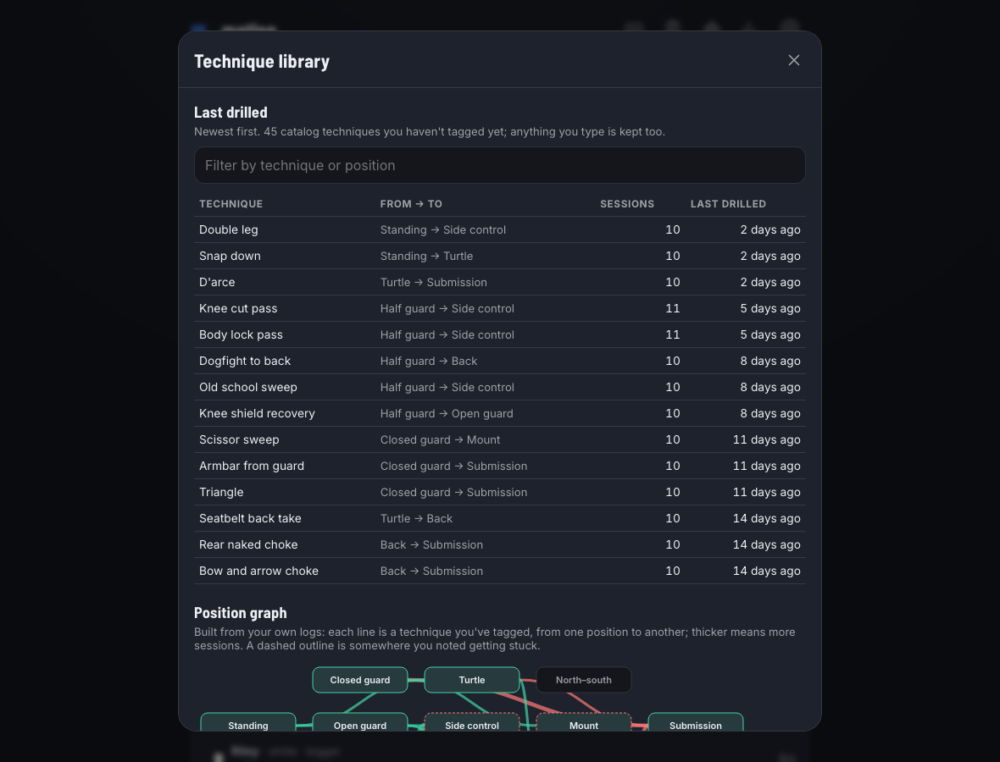
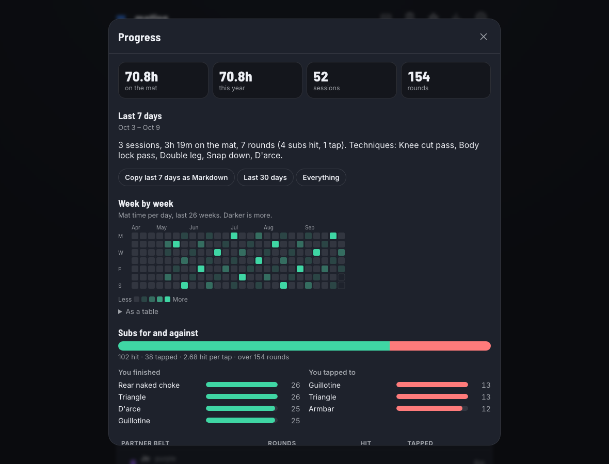
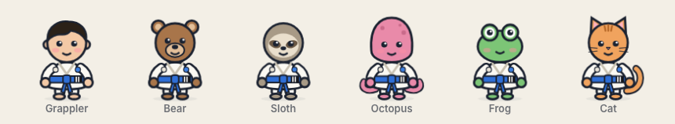
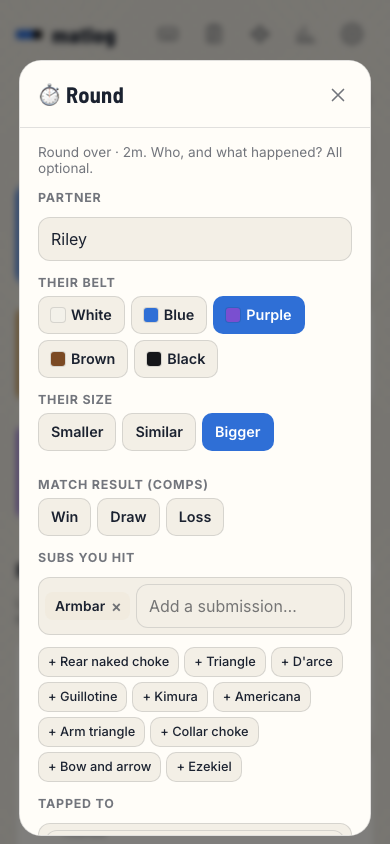

# 🥋 matlog

A BJJ training journal that keeps everything on your phone. One tap starts a class, open mat, drilling session, comp or round, and you get clear ways to see your progress: mat hours, a week-by-week heatmap, subs for and against, where you get stuck, your techniques as a position graph, and your belt and stripe timeline.

**[Open the app →](https://parmsam.github.io/matlog/)** It's free, with no account and no ads, and it works offline.

<p align="center">
  
  &nbsp;
  
</p>

matlog is a sibling of [tinylog](https://github.com/parmsam/tinylog) and uses the same template: one tap to log, easy to log late, patterns but never advice, and your data stays on your device. It's a static site on GitHub Pages; your log lives in your browser's IndexedDB, with a second copy in localStorage.

## Features

**Logging**
- **One tap.** Class, Open mat, Drilling, Comp and Round (plus Study, off by default). A tap logs one you just did, with its length and details. Prefer a timer? Turn off **log past sessions only** in Settings → Buttons, and it's tap to start, tap to stop. Timers are timestamps, so they keep going through reloads, a locked phone or a closed tab. Starting open mat while class runs switches it instead of starting a second session.
- **Topic.** An optional "what the class was about" on any session; when it names a technique, that technique's page lists the sessions on it.
- **Logging late is normal.** Every log shows **Undo**, **−5m / −15m / −30m** and **Details**. With timers on, hold a card to log one you already did, with its length (1 hour for a class by default). Classes start on the hour by default, and the toast always offers the exact time.
- **Open mat flow.** Rounds belong to the session they happen in (class, open mat, drilling, or a comp, where they're matches): a round started during a session or added from its sheet stays with it even if you change its times, and one logged afterwards joins the session it falls in (or ended up to 10 minutes before). A round started on its own offers to start open mat; saving one offers **Next round**; a session's sheet lists its rounds with **+ Add a round**. The **round clock** (<kbd>K</kbd>) is a full-screen gym timer with round and rest lengths that buzzes at time and keeps the screen awake.
- **Round log.** Stopping a round asks who you rolled with (partner, belt, size), where it started (positional rounds, top or bottom), subs you hit, what you tapped to, **moves you landed and moves you went for** (sweeps, passes, takedowns, back takes), and where you got stuck. Every field is optional and one tap away.
- **Situational sparring.** A round can carry its goal or rules ("bottom escapes or sweeps"), a count of how many times you and your partner each got yours (rounds reset and go again), and a line on how it went. The next round in the session starts with the same position, side and goal.

**Train with intention**: everything here lives in one **Notebook** (<kbd>N</kbd>), with tabs for Focus, Problems, Injuries and Reflections.
- **Focus blocks.** Say what you're working on, a few connected skills at a time: a main skill, a complementary one, a habit, an experiment, a side project. Work each in a 1- or 2-week block, then rest it, go again, or call it done. Write where you go if it works and if it fails, and an optional reps target ("1 of 2 reps today"). When a focus names a technique, position or submission, matlog counts what happens in each block, so after a break you can see what stuck. You pick them; matlog never will.
- **Problems.** Find a problem, write an idea to try, mark it solved. Note whether someone told you, you noticed it, or you see it coming, and whether you tinkered before looking it up.
- **Reflect later.** A while after a session (two hours by default), a prompt opens a five-minute notebook: the current block, a problem you hit, an idea to try, and a check-in on whether you enjoyed it and followed your plan. Starting a session shows today's focus in the toast, like glancing at a notebook before rounds. On a laptop, it can also send a notification while matlog is open in another tab.
- **Injury log.** What got hurt (area and side), how bad in your own words, how it happened, what you're doing differently while it heals ("no leg locks, gi only"), dated updates, and when it healed. Log one from a round's sheet ("Got hurt?") or while reflecting, and it's linked to that round. While one is active, the home screen shows a quiet "🩹 Left knee · 12 days" and your buddy wears a small bandage. A record of what you logged, never medical advice.
- **Skill ladder.** For any technique: landed / tried against lighter, same-size and heavier partners, and lower, same and higher belts than yours at the time.
- **Paste a class note.** Paste Markdown or plain text from your notes app and it becomes a session with its rounds. You see a preview before anything is saved.

**Technique library**
- **Edit the library.** Rename any technique (built-in or your own), add other names, change its type and positions, mark it as a **variation** of another (a parent shows its numbers with its variations), or hide built-ins you don't use from suggestions. Built-ins are never deleted, and "Back to the built-in version" undoes your changes.
- **Notes on any technique**: key details (pinned to the top), observations, questions and sources with a link, plus what your sessions and problems already say about it.
- Tag techniques per session from a built-in list of about 60 (takedowns, sweeps, passes, escapes, submissions), or type your own. **Add your own techniques** with a type and where they start and end, and they join the suggestions, the position graph and the skill ladder; anything already logged under that name links up.
- **Last drilled or tried**: every technique you've used, how many sessions you drilled it, and **landed X of Y** in rounds.
- **All**: the whole library by type, A to Z, with what your log says about each. The filter searches names, other names, positions and types, and hidden techniques sit at the end so you can bring them back.
- **Position graph**: standing → guard → passing → mount/back → submission, drawn only from techniques you've drilled or landed. Thicker lines mean more sessions, and a dashed outline marks positions you've noted getting stuck in.

<p align="center">
  
</p>

**Seeing progress**
- Mat hours (all time and this year), sessions and rounds.
- A **week-by-week heatmap** of mat time over 26 weeks, with a table version.
- **Subs for and against**: the ratio, your most-finished subs, what you tap to most, and a breakdown by partner belt.
- **Moves in rounds**: each sweep, pass or takedown you went for, and how often it landed.
- **Where you got stuck**, ranked.
- **Belt and stripe timeline**, with the mat hours between each promotion.
- **Injuries**: by area, days with one active this year, sessions trained around one, and how long they took to heal (median).
- **How sessions felt**: enjoyment by month and how often you followed your plan, from your own check-ins. **Focus blocks** over the last six months, and **positional rounds** by starting position, with how often each side got its goal in situational rounds.
- **Patterns, never advice.** "You noted getting stuck in half guard most: 14 rolls." Each pattern says what it's based on and stays hidden until there's enough data. matlog won't tell you what to drill.

<p align="center">
  
</p>

**Delight**
- **A training buddy.** Pick a Grappler, Bear, Sloth, Octopus, Frog or Cat, or a different one each day. They wear your belt and stripes, tie their belt when a session starts, tap out when you log a tap and cheer a finish. Tap yours for a line.
<p align="center"></p>

- **A splash** of your belt (and stripes) tying itself as the app opens; change your belt in Settings and it plays once so you can see it. It's on by default, a tap skips it, and you can turn it off in Settings.
- **Gi and no-gi themes.** The gi theme is light, with a woven texture; no-gi is dark. Auto follows your system setting.
- **Patches** for 10, 25, 50, 100, 250, 500 and 1,000 mat hours, sewn onto your buddy's gi. There are no streaks, so nothing can be lost.

<p align="center">
  
</p>

## How it compares

Checked on 2026-10-09 against each app's own site and App Store listing. Prices are US prices and change often. "—" means the site didn't say.

| App | Cost | Runs on | Account | Where your log lives | Coaching or advice | Source |
|---|---|---|---|---|---|---|
| **matlog** | Free | Any phone or computer (web app, installable) | No | On your device only | None: describes what you logged | Open ([MIT](LICENSE)) |
| [BJJ Notes](https://www.bjjnotes.app) | Free; Pro $7.90/mo, $59.90/yr or $149 lifetime | iOS, Android | Yes | Their cloud (syncs devices) | AI insights, focus goals | Closed |
| [BJJBuddy](https://bjjbuddy.com/free-training-log-app/) | Free; $5.99/mo or $39.99/yr | iOS, Android | — | — | Video picks "based on your stats" | Closed |
| [BetterBJJ](https://betterbjj.com) | — | iOS, Android | — | — | AI game plans, proficiency scores | Closed |
| [MatTime](https://mattime.app) | $9.99 lifetime | iOS (Android planned) | Yes (public profiles) | — | Streaks, weekly goals, gym leaderboards | Closed |
| [Grapl](https://apps.apple.com/ph/app/grapl-app/id6761396034) | Free (10 roll logs); Pro subscription | iOS | — | — | AI coaching | Closed |
| [GrappleKit](https://grapplekit.com/) | Free; Premium $6.99/mo | — | — | — | Round timer, playlists | Closed |
| [Obsidian](https://obsidian.md) | Free for personal use; Sync $4/mo yearly or $5 monthly | Windows, macOS, Linux, iOS, Android | No (only for Sync) | Markdown files on your device | None | Closed (plugins are open) |
| Notes app or paper | Free | Anywhere | No | Wherever you keep it | None | — |

**Where matlog fits:** it's for someone who wants a fast, good-looking journal with real stats, without a sign-up, a subscription or a coach in the app.
- **Want an AI to tell you what to work on, or a voice-first log?** BJJ Notes and BetterBJJ do that, through their cloud and paid plans.
- **Want leaderboards with your gym?** MatTime does that.
- **Already keep notes in Obsidian, Notes or on paper?** Keep them. Obsidian is great for long-form notes and links between ideas, but it doesn't time rounds or count subs. matlog reads a pasted class note and exports Markdown that drops straight into a vault, so the two work together.
- We looked for "Grapple Log" and found no app by that name.

## Install it on your phone

| Phone | How |
|---|---|
| **iPhone / iPad** (Safari) | **Share** → **Add to Home Screen** → **Add**. |
| **Android** (Chrome) | **⋮** menu → **Add to Home screen** (or **Install app**). |

On iPhone, Safari can clear data for sites you haven't installed, so installing matters. The installed app keeps its own storage, separate from Safari's. If you started in Safari, use **Settings → Export backup** there and **Import backup** in the installed app.

## Keyboard shortcuts

Press <kbd>?</kbd> in the app to see them all.

| Key | Action |
|---|---|
| <kbd>C</kbd> <kbd>O</kbd> <kbd>D</kbd> <kbd>P</kbd> <kbd>R</kbd> | Start / stop class, open mat, drilling, comp, round (with <kbd>Shift</kbd>: log a finished one) |
| <kbd>U</kbd> | Undo |
| <kbd>G</kbd> <kbd>T</kbd> <kbd>V</kbd> | Progress, technique library, paste a class note |
| <kbd>N</kbd> | Notebook (the tab you used last) |
| <kbd>F</kbd> <kbd>B</kbd> <kbd>I</kbd> <kbd>K</kbd> | Notebook → Focus, Problems, Injuries; round clock |
| <kbd>S</kbd> | Start / stop study |
| <kbd>M</kbd> | Copy the last 7 days as Markdown |
| <kbd>,</kbd> | Settings |
| <kbd>Ctrl</kbd>/<kbd>⌘</kbd> <kbd>K</kbd> | Command palette: type a few letters to run any of the above, change the theme, back up, or jump to a technique |

## Shortcuts, Siri and links

Any link with `?do=` logs something when opened, with the usual Undo. **Settings → Shortcuts and Siri** lists ready-made links to copy.

| Link | Does |
|---|---|
| `?do=log&type=open-mat&min=60` | Log a 60-minute open mat that just ended |
| `?do=toggle&type=class` | Start or stop class (also `open-mat`, `drilling`, `comp`, `roll`) |
| `?do=log&type=class&min=90&gi=nogi&tech=knee cut,arm triangle` | A finished no-gi class with techniques |
| `?do=log&type=roll&partner=Jo&belt=blue&sub=rnc&tapped=triangle&stuck=half guard` | A round |
| `?do=log&type=roll&landed=knee cut&tried=berimbolo` | A round where you landed a knee cut and went for a berimbolo |
| `?do=log&type=roll&from=side control&role=bottom` | A positional round from bottom side control |
| `?do=log&type=roll&from=mount&role=bottom&goal=escape&got=2&theygot=1` | A situational round: you escaped twice, got held once |
| `?do=log&type=study&min=10&source=Half guard series` | Ten minutes of study (not mat time) |
| `&ago=30` | It ended (or started) 30 minutes ago |

- **iPhone:** Shortcuts → New Shortcut → **Open URLs**, paste a link, name it "Log open mat". Then say "Hey Siri, log open mat". Links open in Safari, which keeps its own data, separate from the Home Screen app.
- **Android and desktop:** long-press the installed app's icon for Class, Open mat and Round.
- **AI agents and scripts** driving the page can call `window.matlog` (see [`llms.txt`](public/llms.txt)).

## Class notes in Markdown

Paste a class note (**📋 Paste a note**, or <kbd>V</kbd>) and matlog logs the session with its techniques, rounds, problems and injuries. You see what will be logged before anything is saved. Exports use the same format, so a copied week pastes straight back in, and it drops into Obsidian or any notes app.

```markdown
## Class
- Date: 2026-10-08 18:00
- Length: 90m
- Gi: no-gi
- Topic: Half guard passing

### Techniques
- Knee cut pass
  - Key detail: underhook the far arm first
- Shoulder post wrist grab arm drag

### Rounds
- Sam (purple, bigger)
  - Started from: half guard bottom
  - Goal: sweep or come up
  - Got it: 2
  - They got it: 1
  - How it went: came up twice once I got the underhook
  - Hit: armbar
  - Tapped to: triangle
  - Landed: knee cut
  - Stuck: half guard

### Problems
- Got flattened in half guard
  - Idea: knee shield first

### Injuries
- Left knee (minor)
  - How: heel hook
  - Training around it: no leg locks

### Notes
Anything else, as free text.
```

- `## Class` starts a session (Class, Open mat, Drilling, Comp or Study); several can follow each other.
- Session details are bullets: Date, Length, Gi, Topic, Enjoyed (1–5), Followed my plan.
- Each `###` section is a list: one technique, round, problem or injury per bullet, with sub-bullets for its details. Situational rounds add Goal, Got it, They got it and How it went. Technique sub-bullets become notes on that technique (Key detail, Observation, Question, Source).
- Names are forgiving ("knee slice" is a knee cut, "rear naked" is an RNC); anything else is kept as you typed it. Older notes (comma lists, one-line rounds) still work.

**With an AI.** Got a voice memo or a messy note? In the Paste dialog, open **The format** and tap **Copy prompt for an AI**. Paste the prompt into ChatGPT or Claude with your notes, then paste the answer back into matlog. The prompt includes your own technique and partner names, so they match. Claude users can also add the skill in [`skills/matlog-note`](skills/matlog-note/SKILL.md), and agents can read the same spec in [`llms.txt`](public/llms.txt).

## Privacy

Everything stays in your browser: IndexedDB, with a second copy in localStorage. There are no accounts, servers or analytics, and the only network request is for fonts. Partner names never leave your device unless you export them.

Because the browser is the only copy, matlog reminds you to back up: every 7 days by default (3, 14 or 30 in Settings, or only every 30 new entries), with a **Back up now** button right in the reminder. On a phone it opens the share sheet so the file can go to Files, iCloud Drive or Google Drive. Importing a backup merges, so it also moves your log between devices.

## Development

Requires Node 24.

```sh
npm install
npm run dev        # http://localhost:5173/matlog/
npm run check      # typecheck + unit + end-to-end tests; run before committing
SCREENSHOTS=1 npx playwright test screenshots --project=chromium   # refresh docs/*.png
```

| | |
|---|---|
| Stack | Vite + TypeScript (no UI framework), hand-written SVG charts and companion, vite-plugin-pwa |
| Storage | IndexedDB with a localStorage mirror; settings in localStorage |
| Unit tests | Vitest (jsdom), run in `America/New_York` to catch DST bugs |
| E2E tests | Playwright on Chromium, WebKit, an Android phone, iPhone layout, and the production build (offline) |
| Icons | `scripts/icons.mjs` renders one SVG mark to favicon.ico/PNG/SVG, the iOS touch icon, and Android 192/512 + maskable PNGs |
| CI / deploy | Every push runs the tests; `main` deploys to GitHub Pages only if they pass |

The plan, competitor notes and decisions log are in [`PLAN.md`](PLAN.md), and conventions for contributors (human or AI) are in [`AGENTS.md`](AGENTS.md).

## License

[MIT](LICENSE) © 2026 Sam Parmar
